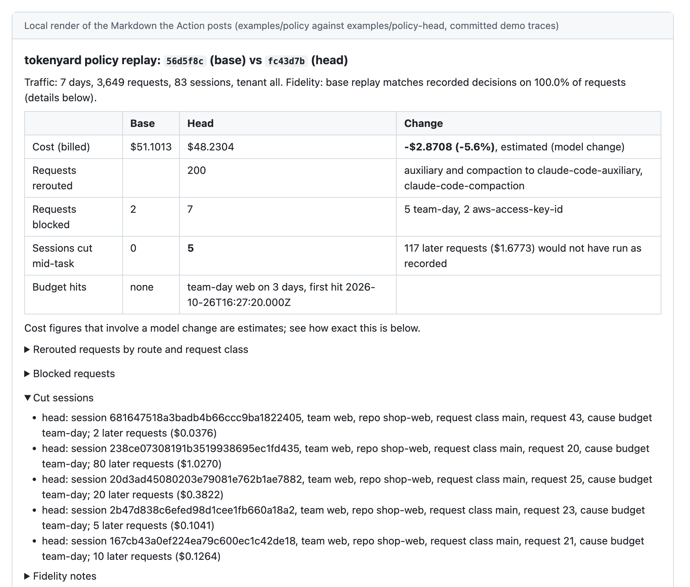
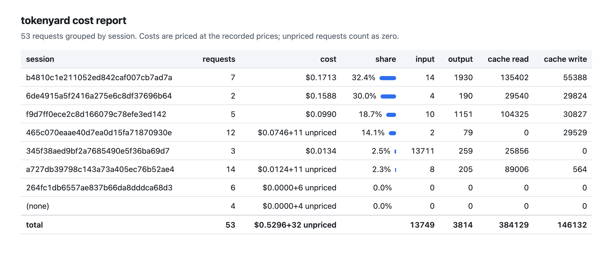

# tokenyard

Policy CI for coding-agent traffic.

tokenyard is an open-source LLM gateway in TypeScript for Claude Code, Codex and product AI features. In the request path it only does mechanism: it forwards the agent's bytes unchanged, enforces budgets, rate limits, model allowlists and secret guardrails, attributes every request to a tenant, team, developer key, repo, session, subagent and request class, and writes a decision trace. Outside the request path, the policy is a YAML file in git, and every pull request that changes it gets a comment computed by replaying recorded traffic through the proposed policy: which requests would route elsewhere, which would be blocked, which budgets would be hit, the cost delta, and how many agent sessions would have been cut off mid-task.

<picture>
  <source media="(prefers-color-scheme: dark)" srcset="docs/demo-comment-dark.png">
  
</picture>

The image is a local render of the Markdown the GitHub Action posts, computed from the committed synthetic demo week (`examples/traces/demo.ndjson.gz`) for the demo policy change (`examples/policy` against `examples/policy-head`). The demo pull request on GitHub does not exist yet; once it is open, a recording of the bot comment appearing after a push replaces this picture. The traffic is synthetic; real sessions, anonymized, are in [Real sessions](#real-sessions).

## Quick start

No API key is needed: both paths run against deterministic mock providers.

```sh
# One process, no Docker: 7 days of synthetic traffic from 8 developers in 3 teams through the gateway,
# then a replay of the demo policy change.
npx @mateuszkania-im/tokenyard demo
# or from a clone
node bin/tokenyard.mjs demo

# Docker Compose 2.20 or later: mock providers, the gateway, the traffic generator, then the replay report.
docker compose up --build --abort-on-container-exit --exit-code-from traffic
docker compose --profile redis up --build --abort-on-container-exit --exit-code-from traffic   # two gateways sharing budgets through Redis
docker compose --profile otel up --build --abort-on-container-exit --exit-code-from traffic    # OTel collector and Jaeger on http://localhost:16686
```

Running it for real:

```sh
tokenyard policy check policy                                  # schema and semantic rules; exits 1 on errors
tokenyard keys create --tenant acme --team web --name alice --file policy/keys.yaml   # prints the key once, stores its SHA-256
tokenyard serve --policy policy --trace-dir traces --trace-salt "$TOKENYARD_TRACE_SALT"
tokenyard serve --policy policy --store redis --redis-url redis://127.0.0.1:6379 --trace-dir traces --trace-salt "$TOKENYARD_TRACE_SALT"
tokenyard traces export --since 7d --trace-dir traces --out traces.ndjson.gz
tokenyard policy replay --base main --head policy --traces traces.ndjson.gz
tokenyard report --traces traces.ndjson.gz --by team,repo --html report.html
```

The provider keys are read from the environment variables the policy names (`credential: { env: ANTHROPIC_API_KEY }`); developers never see them.

## Point Claude Code and Codex at it

Claude Code, two lines per developer:

```sh
export ANTHROPIC_BASE_URL=https://tokenyard.internal.example
export ANTHROPIC_AUTH_TOKEN=ty_live_xxxxxxxx
```

tokenyard reads the key from `x-tokenyard-key`, `Authorization: Bearer` or `x-api-key`, so `ANTHROPIC_API_KEY` works too. Fleet-wide, through Claude Code managed settings, with the gateway pinned as the only allowed destination (`allowedProviders` needs Claude Code v2.1.285 or later, per the [LLM gateway guide](https://code.claude.com/docs/en/llm-gateway)):

```json
{
  "env": {
    "ANTHROPIC_BASE_URL": "https://tokenyard.internal.example",
    "CLAUDE_CODE_GATEWAY_HINT_HEADERS": "1"
  },
  "apiKeyHelper": "tokenyard-key",
  "allowedProviders": ["customEndpoint"]
}
```

`CLAUDE_CODE_GATEWAY_HINT_HEADERS=1` makes Claude Code send its request class, agent type and prompt id, which the trace and the report split cost by. `tokenyard-key` is an example name for your own script that prints the key (for example from the OS keychain); tokenyard does not ship it. For repo, branch and ticket attribution, start Claude Code with `eval "$(tokenyard env)" && claude`; the headers are fixed at launch, so a branch switch mid-session is not reflected.

Codex, in `~/.codex/config.toml` (run `/logout` first if Codex has its own OpenAI login, which it would otherwise prefer):

```toml
model_provider = "tokenyard"

[model_providers.tokenyard]
name = "tokenyard"
base_url = "https://tokenyard.internal.example/v1"
env_key = "TOKENYARD_KEY"
wire_api = "responses"
requires_openai_auth = false
supports_websockets = false
env_http_headers = { "x-tokenyard-repo" = "TOKENYARD_REPO" }
```

A product service uses a service key (`kind: service`) and the base URL in the official SDK; its traffic class comes from the key, never from a header.

## What replay can and cannot tell you

`tokenyard policy replay` runs the base policy and the head policy separately over one merged trace export, each with its own simulated counter store on a virtual clock, and diffs head against base. The decision function is pure and takes every input from the trace, which is what makes this possible. Replay answers who, where and how much; it never answers how good.

| Output | Exactness | Why |
|---|---|---|
| Route and provider per request, model allowlist blocks, guardrail blocks for rules that fired at record time | **Exact** | Pure function of recorded features |
| Budget hits, rate-limit blocks, session cuts | **Exact given the simulation's assumptions**: when cost is exact; a cut session stops; a rate-limited request is not retried | Counter state is rebuilt from the replay itself; Claude Code's retries after a 429 cannot be simulated |
| Cost delta when the model does not change (price table change, budget change) | **Exact** | Same tokens, different prices or admissions |
| Cost delta when the model changes | **Estimated** | Output tokens of a model that never ran are unknown: scaled by the per-model, per-request-class output ratio observed in the traces, or kept equal and flagged when no data exists |
| Cache effect of a model or provider switch within a session | **Estimated** | From the first switched request, all recorded cache reads of that session become 5m cache writes at the new model's price for one request, then the recorded hit pattern resumes. Caches are per workspace and per model ([Prompt caching](https://platform.claude.com/docs/en/build-with-claude/prompt-caching)) |
| A new guardrail rule | **Not computed** | Traces hold no content; the comment says "new secret rules cannot be replayed" |
| Latency | **Not computed in v0.1** | Would need per-provider distributions; listed as future work |
| Answer quality | **Never** | Logs hold no outcome for routes not taken; offline replay is unbiased only when the logging policy chose at random ([Li et al., WSDM 2011](https://arxiv.org/abs/1003.5956)) |

**Fidelity.** Every comment starts with a fidelity line: for the records traced under the base revision, replaying the base must reproduce the recorded decision, and the agreement rate is printed with the reasons for any disagreement (missing counter state at the start of the window, dropped traces, retries the trace cannot see). The check also lists missing instances: an instance that was running during an hour for which the export has no file of it, sequence gaps (dropped records), and an instance whose heartbeats stop without a shutdown record. A low rate or a missing instance means the diff should not be trusted. Replay is deterministic: the same traces and policies give byte-identical JSON and Markdown.

**Admit order.** Replay admits requests in the order the gateway admitted them: each trace records when admit ran (`admitOffsetMs`) and the instance's admit sequence number (`admitSeq`). Within one instance that order is exact. Across several instances sharing Redis it is only approximated, because the instances' clocks and the Redis server's commit order are not recorded together; a burst that hits a budget across instances can replay in a slightly different order than Redis applied it, which shows up as fidelity below 100%.

`policy replay` refuses a raw trace directory and asks for `traces export`, because a partial set would undercount budgets. Budget windows that started before `--since` are seeded from the recorded spend; session taint from before `--since` is not rebuilt.

## The policy file

`examples/policy/policy.yaml`, the policy the demo runs (with `prices.yaml`, every price carrying its source URL and retrieval date, and `keys.yaml`, hashes only):

```yaml
apiVersion: tokenyard/v1
kind: Policy
metadata:
  name: acme-coding-agents
  owners: ["@acme/platform"]          # informational

pricing: ./prices.yaml                # versioned price table; part of the bundle
keys: ./keys.yaml                     # key hash, tenant, team, name, kind (developer|service), billing (api)

providers:
  anthropic:
    format: anthropic
    baseUrl: https://api.anthropic.com
    credential: { env: ANTHROPIC_API_KEY }
  anthropic-backup:                   # second workspace; a fallback here starts a cold cache
    format: anthropic
    baseUrl: https://api.anthropic.com
    credential: { env: ANTHROPIC_API_KEY_BACKUP }
  openai:
    format: openai
    baseUrl: https://api.openai.com/v1
    credential: { env: OPENAI_API_KEY }

tenants:
  acme: { teams: [platform, web, data] }

routes:                               # first match wins
  - name: claude-code
    match: { surface: anthropic-messages, traffic: coding-agent, billing: api }
    chain: [anthropic, anthropic-backup]
    allowModels: ["claude-opus-5-5*", "claude-sonnet-5-5*", "claude-haiku-*"]
    # Server tools are denied unless listed. Claude Code uses web search, and tool search when it defers MCP tools;
    # both are priced in prices.yaml (tool search: no fee, a 10-iteration loop).
    serverTools: [web_search, tool_search_tool_regex, tool_search_tool_bm25]
  - name: codex
    match: { surface: openai-responses, traffic: coding-agent }
    chain: [openai]
  - name: support-summaries
    match: { traffic: product, feature: support-summary }
    chain: [anthropic]
    rewriteModel: claude-haiku-5-5    # product traffic only
    criticality: sheddable
  - name: product-default             # feature comes from a client header, so a header-free route must allow the model too
    match: { traffic: product }
    chain: [anthropic]
    rewriteModel: claude-haiku-5-5
    criticality: sheddable

budgets:
  - { name: org-month,  scope: tenant,  window: month, usd: 6000, onExceed: block }
  - { name: team-day,   scope: team,    window: day,   usd: 300,  onExceed: block }
  - { name: dev-day,    scope: key,     window: day,   usd: 40,   onExceed: block, mode: audit }
  - { name: session,    scope: session,                usd: 25,   onExceed: block, mode: audit }

reservation:
  estimator: worst-case               # worst-case | session-aware
  onOverrun: allow-and-debit
  serverToolsWithoutMaxUses: block    # block | assume (assume prices assumedMaxUses and voids the bound, 7.4)

rateLimits:
  - { name: dev-rpm, scope: key, rpm: 120, burst: 30 }
  - { name: dev-streams, scope: key, concurrentStreams: 8 }   # checked inside admit, released at settle

guardrails:
  secrets:
    rules: default                    # curated prefix rules, section 6.6
    codingAgent: block                # block | warn
    product: redact                   # block | warn | redact
    entropyOnly: warn                 # entropy-only hits never block
    taintTtlHours: 24                 # how long a session stays tainted after a block
  pii:
    product: redact                   # email, PESEL, IBAN, card numbers with Luhn

failure:
  counterStoreDown: { rateLimits: open, budgets: closed }
  unpricedModel: allow-and-flag       # block | allow-and-flag
  breaker: { minRequests: 20, failureRatio: 0.5, windowSeconds: 30, openSeconds: 30 }
  retryBudgetRatio: 0.1

ci:
  failOn:
    cutSessions: 0                    # fail the check if any recorded session would be cut mid-task
    costIncreasePct: 10
```

Budgets start in `mode: audit` (checked and traced, never enforced), and a later pull request switches them to `enforce` with the replay showing what enforcement would have done. `tokenyard policy schema > policy.schema.json` gives editor completion. The gateway validates the policy again at load, swaps it atomically, keeps the last good revision when a new one fails, and reports the active revision in every trace and in `tokenyard_policy_revision_info`. Rewriting the model on coding-agent traffic needs `allowBodyRewrite: true` with a `because:` line on the route; Claude Code is never routed to a non-Claude model. `guardrails.pii.quotedOnly: true` limits PESEL and card number redaction on product routes to values inside JSON strings.

## Measured

Every number below is produced by `npm run bench` into `bench/results.json` and copied into this block by a script; CI fails when the block and the results differ. [docs/benchmarks.md](docs/benchmarks.md) has the commands to reproduce each one and what each measures. Every request goes to the local mock provider, so the absolute times say how the gateway behaves on this machine and nothing about a real provider.

<!-- BENCH:START -->
Measured by `npm run bench` on Apple M2 Pro (12 cores, 16 GB, arm64), darwin 27.0.0, Node v22.14.0; tsx 4.23.15, redis 7.4.12; commit `5a72e15`, run 2026-11-03T02:03:24.628Z. Every request goes to the mock provider on loopback; no real provider is called.

#### SLO targets (spec 12.1)

| SLI | Target | Measured | Result |
|---|---|---|---|
| Added TTFB p50 / p99, non-streaming, 10 streams, memory store | under 5 ms / under 25 ms | 0.44 ms / 0.82 ms (n = 2,200); client-side TTFB outside the provider, p50 / p99: direct 1.56 / 3.82 ms, through the gateway 3.01 / 7.25 ms | met |
| Added TTFB p50 / p99, non-streaming, 100 streams, memory store | under 5 ms / under 25 ms | 0.1 ms / 0.24 ms (n = 5,000); client-side TTFB outside the provider, p50 / p99: direct 0.26 / 2.35 ms, through the gateway 0.63 / 3.18 ms | met |
| Added TTFB p50 / p99, non-streaming, 500 streams, memory store | under 5 ms / under 25 ms | 0.04 ms / 0.09 ms (n = 25,000); client-side TTFB outside the provider, p50 / p99: direct 0.4 / 4.44 ms, through the gateway 4.71 / 677.02 ms | missed |
| Added TTFB p50 / p99, streaming 500 tokens, 10 streams, memory store | under 5 ms / under 25 ms | 0.48 ms / 1.12 ms (n = 2,200); client-side TTFB outside the provider, p50 / p99: direct 0.43 / 2.15 ms, through the gateway 1.8 / 5.48 ms | met |
| Added TTFB p50 / p99, streaming 500 tokens, 100 streams, memory store | under 5 ms / under 25 ms | 0.08 ms / 0.31 ms (n = 2,252); client-side TTFB outside the provider, p50 / p99: direct 0.24 / 2.75 ms, through the gateway 0.65 / 2.97 ms | met |
| Added TTFB p50 / p99, streaming 500 tokens, 500 streams, memory store | under 5 ms / under 25 ms | 0.05 ms / 0.13 ms (n = 6,261); client-side TTFB outside the provider, p50 / p99: direct 0.52 / 2.83 ms, through the gateway 10.13 / 18.21 ms | missed |
| Added TTFB p50 / p99, streaming 150 KB body, 10 streams, memory store | under 5 ms / under 25 ms | 9.34 ms / 13.92 ms (n = 2,200); client-side TTFB outside the provider, p50 / p99: direct 0.68 / 2.76 ms, through the gateway 11.79 / 31.28 ms | missed |
| Added TTFB p50 / p99, streaming 150 KB body, 100 streams, memory store | under 5 ms / under 25 ms | 4.03 ms / 5.21 ms (n = 2,251); client-side TTFB outside the provider, p50 / p99: direct 0.21 / 2.42 ms, through the gateway 10.32 / 30.53 ms | missed |
| Added TTFB p50 / p99, streaming 150 KB body, 500 streams, memory store | under 5 ms / under 25 ms | 4.02 ms / 6.11 ms (n = 6,233); client-side TTFB outside the provider, p50 / p99: direct 308.71 / 749.52 ms, through the gateway 11518.26 / 19953.45 ms | missed |
| Added TTFB p50 / p99, non-streaming, 10 streams, redis store | under 5 ms / under 25 ms | 1.74 ms / 4.61 ms (n = 2,200); client-side TTFB outside the provider, p50 / p99: direct 1.56 / 3.82 ms, through the gateway 4.24 / 9.38 ms | met |
| Added TTFB p50 / p99, non-streaming, 100 streams, redis store | under 5 ms / under 25 ms | 1.05 ms / 35.3 ms (n = 5,000); client-side TTFB outside the provider, p50 / p99: direct 0.26 / 2.35 ms, through the gateway 1.68 / 37.15 ms | missed |
| Added TTFB p50 / p99, non-streaming, 500 streams, redis store | under 5 ms / under 25 ms | 13.21 ms / 108.53 ms (n = 25,000); client-side TTFB outside the provider, p50 / p99: direct 0.4 / 4.44 ms, through the gateway 84.19 / 1807.58 ms | missed |
| Added TTFB p50 / p99, streaming 500 tokens, 10 streams, redis store | under 5 ms / under 25 ms | 2.41 ms / 4.42 ms (n = 2,200); client-side TTFB outside the provider, p50 / p99: direct 0.43 / 2.15 ms, through the gateway 3.65 / 8.14 ms | met |
| Added TTFB p50 / p99, streaming 500 tokens, 100 streams, redis store | under 5 ms / under 25 ms | 1.15 ms / 3.7 ms (n = 2,250); client-side TTFB outside the provider, p50 / p99: direct 0.24 / 2.75 ms, through the gateway 1.63 / 5.88 ms | met |
| Added TTFB p50 / p99, streaming 500 tokens, 500 streams, redis store | under 5 ms / under 25 ms | 3.89 ms / 9.85 ms (n = 6,240); client-side TTFB outside the provider, p50 / p99: direct 0.52 / 2.83 ms, through the gateway 12.6 / 23.49 ms | missed |
| Added TTFB p50 / p99, streaming 150 KB body, 10 streams, redis store | under 5 ms / under 25 ms | 10.25 ms / 17.96 ms (n = 2,200); client-side TTFB outside the provider, p50 / p99: direct 0.68 / 2.76 ms, through the gateway 12.56 / 22.99 ms | missed |
| Added TTFB p50 / p99, streaming 150 KB body, 100 streams, redis store | under 5 ms / under 25 ms | 9.54 ms / 29.14 ms (n = 2,261); client-side TTFB outside the provider, p50 / p99: direct 0.21 / 2.42 ms, through the gateway 21.73 / 57.46 ms | missed |
| Added TTFB p50 / p99, streaming 150 KB body, 500 streams, redis store | under 5 ms / under 25 ms | 771.97 ms / 1004.49 ms (n = 522); client-side TTFB outside the provider, p50 / p99: direct 308.71 / 749.52 ms, through the gateway 3873.78 / 17802.81 ms | missed |
| Gateway-attributable error rate | under 0.1% per month | not measured (a production SLI); overhead runs: 5730 errors beside 127768 answered requests through the gateway | not measured |
| Policy propagation, merge to all instances, p99 | under 60 s | not measured | not measured |
| Admitted spend above an enforced budget (worst-case estimator) | zero | $0 over 2 run(s) of 1,000 requests sent at once (memory, redis) | met |
| Conformance suite on the pinned Claude Code and Codex versions | 100% | not measured by the benchmark (docs/conformance.md) | not measured |
| Cache hit ratio through tokenyard versus direct, same session on the mock | equal | 95.65% versus 95.65% | met |
| Replay of 1,000,000 trace records | under 60 s on a CI runner | 41.2 s on the machine above (not a CI runner) | met |

#### Gateway overhead

An open-loop load generator in the benchmark process sends each scenario to the mock provider directly and through the gateway (each in its own process, loopback). The mock answers after a fixed 100 ms time to first token and streams 500 tokens at 2000 tokens/s. Each stream is one keep-alive connection, opened before the run, with its own schedule of evenly spaced send times (5 requests/s non-streaming, 1.25 requests/s streaming) starting at a seeded random phase, so connections do not fire together; a request still running at the next scheduled time delays the next one, and client-side latency always counts from the scheduled time (coordinated omission included). Added TTFB is the gateway's own per-request measure from its traces (`addedTtfbMs`: from the start of request handling to forwarding upstream, with a sub-millisecond clock in the benchmark), so it is paired per request; it does not include time a request waits before the gateway starts handling it, nor the response path. The client-side columns are absolute percentiles of each path, never subtracted from each other; "outside the provider" is each request's TTFB minus the mock's own wait for that request (the `x-mock-wait-ms` header), paired per request, so the mock's timer jitter drops out. An added TTFB SLO row is met only when both the gateway-measured value and the client-side TTFB outside the provider through the gateway (an upper bound on what the gateway adds, which includes queueing before handling) are under target. n is the number of samples behind each percentile. CPU is the gateway process's user plus system time over the run's wall time (100% is one core); RSS growth is its peak during the run above its size just before it; per 100 streams is the slope between 100 and 500 streams. The gateway runs examples/policy with every budget level enforced at a limit the load never reaches, no rate limits, guardrails on, traces written and metrics kept.

Errors count non-2xx answers and socket errors; scheduled requests the run could not send within its drain time are listed as dropped in bench/results.json.

Memory store:

| Scenario | Streams | Added TTFB p50 / p95 / p99 (ms), gateway-measured | TTFB outside the provider p50 / p99 (ms), direct | Same, through the gateway | Total time p50 / p99 (ms), direct | Same, through the gateway | Gateway CPU | Gateway RSS growth | Errors (direct / gateway) |
|---|---:|---|---|---|---|---|---:|---:|---:|
| Non-streaming, small body | 10 | 0.44 / 0.72 / 0.82 (n = 2,200) | 1.56 / 3.82 | 3.01 / 7.25 | 102.74 / 106.22 | 104.89 / 109.62 | 21.6% | 31.5 MB | 0 / 0 |
| Non-streaming, small body | 100 | 0.10 / 0.15 / 0.24 (n = 5,000) | 0.26 / 2.35 | 0.63 / 3.18 | 100.69 / 103.72 | 100.97 / 103.92 | 52.3% | 7.8 MB | 0 / 0 |
| Non-streaming, small body | 500 | 0.04 / 0.06 / 0.09 (n = 25,000) | 0.40 / 4.44 | 4.71 / 677.02 | 100.73 / 105.45 | 104.87 / 779.45 | 100.2% | 201.8 MB | 0 / 0 |
| Streaming, 500 tokens | 10 | 0.48 / 0.87 / 1.12 (n = 2,200) | 0.43 / 2.15 | 1.80 / 5.48 | 355.02 / 366.58 | 356.21 / 390.42 | 18.6% | 18.9 MB | 0 / 0 |
| Streaming, 500 tokens | 100 | 0.08 / 0.14 / 0.31 (n = 2,252) | 0.24 / 2.75 | 0.65 / 2.97 | 393.56 / 422.55 | 368.18 / 380.97 | 48.9% | 11.3 MB | 0 / 0 |
| Streaming, 500 tokens | 500 | 0.05 / 0.09 / 0.13 (n = 6,261) | 0.52 / 2.83 | 10.13 / 18.21 | 421.11 / 447.48 | 423.46 / 444.36 | 109.3% | 100.5 MB | 0 / 0 |
| Streaming, 150 KB body | 10 | 9.34 / 12.37 / 13.92 (n = 2,200) | 0.68 / 2.76 | 11.79 / 31.28 | 360.20 / 378.64 | 362.68 / 380.10 | 23.0% | 105.6 MB | 0 / 0 |
| Streaming, 150 KB body | 100 | 4.03 / 4.64 / 5.21 (n = 2,251) | 0.21 / 2.42 | 10.32 / 30.53 | 366.06 / 379.50 | 352.92 / 376.59 | 87.0% | 51.4 MB | 0 / 0 |
| Streaming, 150 KB body | 500 | 4.02 / 5.04 / 6.11 (n = 6,233) | 308.71 / 749.52 | 11,518.26 / 19,953.45 | 1,195.72 / 1,543.82 | 11,620.22 / 20,232.61 | 110.0% | 246.1 MB | 0 / 0 |

Redis store:

| Scenario | Streams | Added TTFB p50 / p95 / p99 (ms), gateway-measured | TTFB outside the provider p50 / p99 (ms), direct | Same, through the gateway | Total time p50 / p99 (ms), direct | Same, through the gateway | Gateway CPU | Gateway RSS growth | Errors (direct / gateway) |
|---|---:|---|---|---|---|---|---:|---:|---:|
| Non-streaming, small body | 10 | 1.74 / 3.50 / 4.61 (n = 2,200) | 1.56 / 3.82 | 4.24 / 9.38 | 102.74 / 106.22 | 105.60 / 110.79 | 23.0% | 30.6 MB | 0 / 0 |
| Non-streaming, small body | 100 | 1.05 / 3.46 / 35.30 (n = 5,000) | 0.26 / 2.35 | 1.68 / 37.15 | 100.69 / 103.72 | 102.01 / 137.14 | 50.5% | 6.5 MB | 0 / 0 |
| Non-streaming, small body | 500 | 13.21 / 40.08 / 108.53 (n = 25,000) | 0.40 / 4.44 | 84.19 / 1,807.58 | 100.73 / 105.45 | 184.66 / 1,910.70 | 94.7% | 241.3 MB | 0 / 0 |
| Streaming, 500 tokens | 10 | 2.41 / 3.61 / 4.42 (n = 2,200) | 0.43 / 2.15 | 3.65 / 8.14 | 355.02 / 366.58 | 357.95 / 372.37 | 20.1% | 71.3 MB | 0 / 0 |
| Streaming, 500 tokens | 100 | 1.15 / 2.50 / 3.70 (n = 2,250) | 0.24 / 2.75 | 1.63 / 5.88 | 393.56 / 422.55 | 363.46 / 375.34 | 48.3% | 7.2 MB | 0 / 0 |
| Streaming, 500 tokens | 500 | 3.89 / 8.32 / 9.85 (n = 6,240) | 0.52 / 2.83 | 12.60 / 23.49 | 421.11 / 447.48 | 422.61 / 441.49 | 109.7% | 131.1 MB | 0 / 0 |
| Streaming, 150 KB body | 10 | 10.25 / 14.06 / 17.96 (n = 2,200) | 0.68 / 2.76 | 12.56 / 22.99 | 360.20 / 378.64 | 363.54 / 382.32 | 24.6% | 102.6 MB | 0 / 0 |
| Streaming, 150 KB body | 100 | 9.54 / 22.52 / 29.14 (n = 2,261) | 0.21 / 2.42 | 21.73 / 57.46 | 366.06 / 379.50 | 367.02 / 405.89 | 89.4% | 130.7 MB | 0 / 0 |
| Streaming, 150 KB body | 500 | 771.97 / 983.73 / 1,004.49 (n = 522) | 308.71 / 749.52 | 3,873.78 / 17,802.81 | 1,195.72 / 1,543.82 | 3,975.99 / 18,177.89 | 109.4% | 638.4 MB | 0 / 5,730 |

Gateway cost per 100 more streams (slope between two levels):

| Store | Scenario | Streams | CPU per 100 streams | RSS growth per 100 streams |
|---|---|---|---:|---:|
| memory | Non-streaming, small body | 100 to 500 | 12.0% (gateway saturated at 500 streams, so this understates it) | 48.5 MB |
| redis | Non-streaming, small body | 100 to 500 | 11.1% | 58.7 MB |
| memory | Streaming, 500 tokens | 100 to 500 | 15.1% (gateway saturated at 500 streams, so this understates it) | 22.3 MB |
| redis | Streaming, 500 tokens | 100 to 500 | 15.4% (gateway saturated at 500 streams, so this understates it) | 31.0 MB |
| memory | Streaming, 150 KB body | 100 to 500 | 5.8% (gateway saturated at 500 streams, so this understates it) | 48.7 MB |
| redis | Streaming, 150 KB body | 100 to 500 | 5.0% (gateway saturated at 500 streams, so this understates it) | 126.9 MB |

<details><summary>Every concurrency level, with client-side TTFB from the scheduled send time</summary>

| Store | Scenario | Streams | Rate per stream (req/s) | Seconds | Answered (direct / gateway) | Added TTFB p50 / p95 / p99 (ms) | TTFB p50 / p95 / p99 (ms), direct | Same, through the gateway | Gateway CPU | Gateway RSS |
|---|---|---:|---:|---:|---:|---|---|---|---:|---:|
| memory | Non-streaming, small body | 1 | 5.00 | 20 | 100 / 100 | 1.10 / 1.43 / 1.57 | 105.59 / 106.90 / 107.98 | 108.20 / 110.16 / 111.00 | 4.2% | 109.8 MB |
| redis | Non-streaming, small body | 1 | 5.00 | 20 | 100 / 100 | 3.11 / 4.25 / 4.85 | 105.59 / 106.90 / 107.98 | 109.65 / 112.61 / 116.71 | 4.5% | 129.3 MB |
| memory | Non-streaming, small body | 10 | 5.00 | 44 | 2,200 / 2,200 | 0.44 / 0.72 / 0.82 | 102.63 / 105.16 / 106.08 | 104.56 / 107.37 / 109.17 | 21.6% | 141.3 MB |
| redis | Non-streaming, small body | 10 | 5.00 | 44 | 2,200 / 2,200 | 1.74 / 3.50 / 4.61 | 102.63 / 105.16 / 106.08 | 105.37 / 108.86 / 110.54 | 23.0% | 159.9 MB |
| memory | Non-streaming, small body | 16 | 5.00 | 5 | 400 / 400 | 0.38 / 0.66 / 0.76 | 102.17 / 104.52 / 105.35 | 103.81 / 107.10 / 112.13 | 22.4% | 138.0 MB |
| redis | Non-streaming, small body | 16 | 5.00 | 5 | 400 / 400 | 1.54 / 2.95 / 4.27 | 102.17 / 104.52 / 105.35 | 104.77 / 108.10 / 109.81 | 29.0% | 157.4 MB |
| memory | Non-streaming, small body | 64 | 5.00 | 5 | 1,600 / 1,600 | 0.12 / 0.24 / 0.47 | 100.82 / 102.65 / 104.14 | 101.30 / 103.82 / 105.33 | 46.5% | 149.6 MB |
| redis | Non-streaming, small body | 64 | 5.00 | 5 | 1,600 / 1,600 | 1.14 / 2.16 / 2.87 | 100.82 / 102.65 / 104.14 | 102.35 / 104.74 / 106.56 | 47.5% | 164.4 MB |
| memory | Non-streaming, small body | 100 | 5.00 | 10 | 5,000 / 5,000 | 0.10 / 0.15 / 0.24 | 100.64 / 102.25 / 103.66 | 100.88 / 102.65 / 103.82 | 52.3% | 157.3 MB |
| redis | Non-streaming, small body | 100 | 5.00 | 10 | 5,000 / 5,000 | 1.05 / 3.46 / 35.30 | 100.64 / 102.25 / 103.66 | 101.94 / 105.84 / 137.12 | 50.5% | 171.1 MB |
| memory | Non-streaming, small body | 256 | 5.00 | 5 | 6,400 / 6,400 | 0.05 / 0.10 / 0.17 | 100.60 / 102.26 / 105.01 | 100.95 / 215.01 / 266.99 | 79.0% | 211.7 MB |
| redis | Non-streaming, small body | 256 | 5.00 | 5 | 6,400 / 6,400 | 0.64 / 1.41 / 2.05 | 100.60 / 102.26 / 105.01 | 101.00 / 102.62 / 103.75 | 75.4% | 254.7 MB |
| memory | Non-streaming, small body | 500 | 5.00 | 10 | 25,000 / 25,000 | 0.04 / 0.06 / 0.09 | 100.70 / 102.91 / 105.41 | 104.82 / 669.87 / 779.43 | 100.2% | 299.9 MB |
| redis | Non-streaming, small body | 500 | 5.00 | 10 | 25,000 / 25,000 | 13.21 / 40.08 / 108.53 | 100.70 / 102.91 / 105.41 | 184.63 / 1,682.74 / 1,910.69 | 94.7% | 355.5 MB |
| memory | Streaming, 500 tokens | 1 | 1.25 | 20 | 25 / 25 | 1.22 / 1.31 / 1.36 | 105.05 / 106.84 / 106.96 | 110.45 / 124.11 / 157.42 | 4.2% | 110.4 MB |
| redis | Streaming, 500 tokens | 1 | 1.25 | 20 | 25 / 25 | 3.61 / 4.74 / 5.75 | 105.05 / 106.84 / 106.96 | 113.51 / 127.71 / 163.90 | 5.3% | 119.2 MB |
| memory | Streaming, 500 tokens | 10 | 1.25 | 176 | 2,200 / 2,200 | 0.48 / 0.87 / 1.12 | 100.93 / 102.28 / 103.17 | 102.31 / 104.55 / 107.34 | 18.6% | 111.6 MB |
| redis | Streaming, 500 tokens | 10 | 1.25 | 176 | 2,200 / 2,200 | 2.41 / 3.61 / 4.42 | 100.93 / 102.28 / 103.17 | 104.08 / 106.35 / 108.51 | 20.1% | 116.4 MB |
| memory | Streaming, 500 tokens | 16 | 1.25 | 15 | 300 / 301 | 0.43 / 0.66 / 0.87 | 100.80 / 101.91 / 102.81 | 101.90 / 103.57 / 107.17 | 25.8% | 93.1 MB |
| redis | Streaming, 500 tokens | 16 | 1.25 | 15 | 300 / 296 | 2.03 / 3.51 / 4.64 | 100.80 / 101.91 / 102.81 | 103.53 / 106.33 / 111.08 | 25.4% | 118.3 MB |
| memory | Streaming, 500 tokens | 64 | 1.25 | 5 | 398 / 394 | 0.13 / 0.36 / 0.60 | 101.21 / 102.98 / 103.69 | 101.20 / 103.08 / 105.49 | 43.2% | 106.2 MB |
| redis | Streaming, 500 tokens | 64 | 1.25 | 5 | 398 / 398 | 1.56 / 3.03 / 4.17 | 101.21 / 102.98 / 103.69 | 102.53 / 104.82 / 109.56 | 45.1% | 127.8 MB |
| memory | Streaming, 500 tokens | 100 | 1.25 | 18 | 2,251 / 2,252 | 0.08 / 0.14 / 0.31 | 101.32 / 103.41 / 104.72 | 101.07 / 102.71 / 103.82 | 48.9% | 116.1 MB |
| redis | Streaming, 500 tokens | 100 | 1.25 | 18 | 2,251 / 2,250 | 1.15 / 2.50 / 3.70 | 101.32 / 103.41 / 104.72 | 102.07 / 104.41 / 106.22 | 48.3% | 126.3 MB |
| memory | Streaming, 500 tokens | 256 | 1.25 | 5 | 1,598 / 1,602 | 0.05 / 0.09 / 0.15 | 101.29 / 102.98 / 103.86 | 101.02 / 102.96 / 104.03 | 71.4% | 126.8 MB |
| redis | Streaming, 500 tokens | 256 | 1.25 | 5 | 1,598 / 1,599 | 1.18 / 2.18 / 3.35 | 101.29 / 102.98 / 103.86 | 101.94 / 104.60 / 106.50 | 72.0% | 148.3 MB |
| memory | Streaming, 500 tokens | 500 | 1.25 | 10 | 6,245 / 6,261 | 0.05 / 0.09 / 0.13 | 102.03 / 104.48 / 105.49 | 111.37 / 116.33 / 119.59 | 109.3% | 177.7 MB |
| redis | Streaming, 500 tokens | 500 | 1.25 | 10 | 6,245 / 6,240 | 3.89 / 8.32 / 9.85 | 102.03 / 104.48 / 105.49 | 113.80 / 121.06 / 124.94 | 109.7% | 218.5 MB |
| memory | Streaming, 150 KB body | 1 | 1.25 | 20 | 25 / 25 | 12.84 / 15.12 / 17.04 | 108.81 / 110.19 / 110.40 | 121.41 / 125.49 / 128.56 | 6.3% | 102.1 MB |
| redis | Streaming, 150 KB body | 1 | 1.25 | 20 | 25 / 25 | 14.09 / 17.35 / 18.57 | 108.81 / 110.19 / 110.40 | 122.28 / 127.96 / 128.22 | 5.9% | 115.4 MB |
| memory | Streaming, 150 KB body | 10 | 1.25 | 176 | 2,200 / 2,200 | 9.34 / 12.37 / 13.92 | 103.68 / 105.66 / 106.59 | 113.63 / 129.81 / 133.43 | 23.0% | 150.8 MB |
| redis | Streaming, 150 KB body | 10 | 1.25 | 176 | 2,200 / 2,200 | 10.25 / 14.06 / 17.96 | 103.68 / 105.66 / 106.59 | 114.23 / 119.91 / 124.36 | 24.6% | 147.5 MB |
| memory | Streaming, 150 KB body | 16 | 1.25 | 15 | 300 / 303 | 7.43 / 11.04 / 13.33 | 103.51 / 105.57 / 107.42 | 110.66 / 120.33 / 122.72 | 30.4% | 138.4 MB |
| redis | Streaming, 150 KB body | 16 | 1.25 | 15 | 300 / 297 | 10.07 / 27.63 / 31.60 | 103.51 / 105.57 / 107.42 | 115.52 / 142.74 / 145.27 | 29.1% | 151.7 MB |
| memory | Streaming, 150 KB body | 64 | 1.25 | 5 | 398 / 405 | 4.70 / 5.41 / 6.12 | 102.73 / 105.38 / 107.24 | 108.53 / 125.39 / 128.07 | 65.1% | 156.6 MB |
| redis | Streaming, 150 KB body | 64 | 1.25 | 5 | 398 / 403 | 6.02 / 16.66 / 20.87 | 102.73 / 105.38 / 107.24 | 113.33 / 131.00 / 136.56 | 62.9% | 179.1 MB |
| memory | Streaming, 150 KB body | 100 | 1.25 | 18 | 2,253 / 2,251 | 4.03 / 4.64 / 5.21 | 101.87 / 103.68 / 104.79 | 111.34 / 124.70 / 131.21 | 87.0% | 193.2 MB |
| redis | Streaming, 150 KB body | 100 | 1.25 | 18 | 2,253 / 2,261 | 9.54 / 22.52 / 29.14 | 101.87 / 103.68 / 104.79 | 122.86 / 145.48 / 157.95 | 89.4% | 245.3 MB |
| memory | Streaming, 150 KB body | 256 | 1.25 | 5 | 1,606 / 1,603 | 3.99 / 5.06 / 6.12 | 101.55 / 103.66 / 104.94 | 2,149.14 / 3,157.59 / 3,296.91 | 111.9% | 365.1 MB |
| redis | Streaming, 150 KB body | 256 | 1.25 | 5 | 1,606 / 1,597 | 292.82 / 765.41 / 866.95 | 101.55 / 103.66 / 104.94 | 2,285.58 / 4,052.59 / 4,252.52 | 99.9% | 423.9 MB |
| memory | Streaming, 150 KB body | 500 | 1.25 | 10 | 6,245 / 6,233 | 4.02 / 5.04 / 6.11 | 415.52 / 828.80 / 856.97 | 11,619.96 / 19,650.55 / 20,053.90 | 110.0% | 487.2 MB |
| redis | Streaming, 150 KB body | 500 | 1.25 | 10 | 6,245 / 522 | 771.97 / 983.73 / 1,004.49 | 415.52 / 828.80 / 856.97 | 3,975.79 / 17,566.07 / 17,903.73 | 109.4% | 791.1 MB |

</details>

#### Budget correctness

The G4 proof scenario of spec 7.4: requests sent at the same moment, each on its own connection opened beforehand, through the gateway against one enforced budget, each with an actual cost drawn (seeded) between 0 and its limits. "Admit calls before the first settle" counts the requests the store decided while the first admitted ones were still open.

| Store | Estimator | Budget | Requests sent at once | Admit calls before the first settle | Most open reservations | Admitted | Rejected | Final spend | Max spent + reserved after any admit | Max overspend | Final spend minus settled costs | Reserved left |
|---|---|---:|---:|---:|---:|---:|---:|---:|---:|---:|---:|---:|
| memory | worst-case | $1.00 | 1,000 | 1,000 | 16 | 16 | 984 | $0.120120 | $0.998049 | $0.000000 | 0 micro-USD | 0 micro-USD |
| redis | worst-case | $1.00 | 1,000 | 1,000 | 16 | 16 | 984 | $0.120120 | $0.998049 | $0.000000 | 0 micro-USD | 0 micro-USD |
| memory | session-aware | $1.00 | 1,000 | 1,000 | 16 | 16 | 984 | $0.120120 | $0.998049 | $0.000000 | 0 micro-USD | 0 micro-USD |
| redis | session-aware | $1.00 | 1,000 | 1,000 | 16 | 16 | 984 | $0.120120 | $0.998049 | $0.000000 | 0 micro-USD | 0 micro-USD |

Concurrency trade-off: one 150,000-byte turn with max_tokens 32,000 on claude-opus-5-5, sent concurrently in one session under a $25.00 session budget (enforced), while the mock holds every stream open:

| Estimator | Reservation per turn | Turns admitted in flight |
|---|---:|---:|
| worst-case | $2.0600 | 12 of 40 |
| session-aware | $2.0600 | 12 of 40 |

session-aware reserves the same as worst-case here: the estimator is not given the session's previous cache read share yet (src/policy/decide.ts passes none), and the route sets no reserveOutputTokens.

#### Cache economics

The 40-turn Claude Code shaped session of conformance test C15, priced at claude-opus-5-5 list prices:

| Path | Session cost | Uncached input tokens | Cache read tokens | Cache write tokens | Cache hit ratio |
|---|---:|---:|---:|---:|---:|
| direct | $0.1574 | 0 | 338,518 | 15,384 | 95.65% |
| tokenyard | $0.1574 | 0 | 338,518 | 15,384 | 95.65% |
| naive proxy | $0.1572 | 0 | 337,972 | 15,370 | 95.65% |

The naive proxy flattens `system` into a string, which drops the cache breakpoint on the system block. This session also marks the newest user block, and that breakpoint caches the whole prefix, the flattened system text included, so through the naive proxy the session still reads almost the same prefix from cache and costs about the same; its usage still differs from the direct run (conformance test C15b fails on it).

#### Secret scan

Default rules on a 4.1 MiB synthetic coding-agent body: last-turn scan 85.7 MiB/s, full-body scan 45.4 MiB/s. False-positive corpus (source trees and lockfiles sent as tool results): 683 files, 6.7 MB, 0 block hits.

#### Replay throughput

1,000,000 synthetic trace records (the demo week repeated, 100.4 MB gzipped export) read, parsed and replayed against the demo's base and head policies in 41.2 s (24,260 records/s, fidelity 100.0%).

#### Estimator calibration

| Traces | Requests with usage | Bounds (bytes / context-window) | Bytes bound to billed input, min / median / max | Reservation to actual cost, min / median / max | Billed input above bound |
|---|---:|---:|---|---|---:|
| Demo traffic (mock provider, 4 bytes per token) | 3,647 | 3,647 / 0 | 4.04 / 5.44 / 66.37 | 12.70 / 32.55 / 544.76 | 0 |
| Live Claude Code 2.1.316, 2026-11-02 | 18 | 16 / 2 | 2.88 / 2.91 / 2.95 | 22.52 / 230.85 / 1,448.02 | 0 |
| Live Codex 0.166.0, 2026-11-02 | 3 | 1 / 2 | 5.03 / 5.03 / 5.03 | 68.07 / 493.65 / 719.10 | 0 |

Live rows come from the local live runs through tokenyard (spec 14.1) and are aggregates only.
<!-- BENCH:END -->

How to read it. The added TTFB targets are met for small bodies at 10 and 100 streams, except the Redis store's non-streaming p99 at 100 streams. They are missed at 500 streams, where the gateway process saturates a core and requests queue before it handles them, and for the 150 KB body at every level, where the gateway reads, hashes and scans each body before forwarding it. With the 150 KB body at 500 streams the load generator in the same process saturated too (the direct path's own TTFB rises), so that row is an upper bound on the machine, not on the gateway alone. Streaming totals vary from run to run by more than the gateway adds. The cache row shows that the naive proxy's damage depends on where the breakpoints are: on this session the flattened system block costs almost nothing, and conformance test C15b still fails it on the changed usage.

## Real sessions

Real Claude Code and Codex sessions through tokenyard against the real APIs, on Claude Code 2.1.316 and Codex 0.166.0, on 2026-11-02 (UTC). They ran through the live harness, which enforces a hard cap on the spend of all live runs together with tokenyard's own budget. The data is the anonymized export in [examples/live](examples/live): `live.ndjson.gz` (written by `traces export --anonymize` with a one-off salt that was never stored), the HTML report built from that file only, and `summary.json` (aggregates computed from it by `bench/live-summary.ts`). Tenants, teams, keys and repos are pseudonyms, client versions are dropped, sessions are HMACs, and traces never hold prompt text.

<picture>
  <source media="(prefers-color-scheme: dark)" srcset="examples/live/report-dark.png">
  
</picture>

Cost per Claude Code session, tokenyard's own figure against the `total_cost_usd` Claude Code printed at the end of each session (copied from [the live log](test/live/claude-code.live.md)):

| Session | Model | Billed requests | Main and subagent turns | tokenyard | Claude Code | Cache hit ratio |
|---|---|---:|---|---:|---:|---:|
| 1 | Sonnet 5.5 | 7 | 4 and 3 | $0.171340 | $0.1713382 | 70.96% |
| 2 | Sonnet 5.5 | 5 | 3 and 2 | $0.099030 | $0.0990300 | 77.19% |
| 3 | Opus 5.5 | 2 | 2 and 0 | $0.158844 | $0.1588440 | 49.76% |
| 4 | Sonnet 5.5 | 1 | 1 and 0 | $0.074617 | $0.0746165 | 0.00% |
| 5 | Sonnet 5.5 | 3 | 3 and 0 | $0.012376 | $0.0123766 | 99.36% |

- **Cost.** Over the 5 sessions tokenyard counted $0.516207 and Claude Code $0.5162053. tokenyard rounds each request half up to a whole micro-USD; Claude Code reports a float. Per request, the token counts were equal to Claude Code's own OTel `api_request` events wherever both were captured ([the live log](test/live/claude-code.live.md) has the join).
- **Cache.** Cache reads were 71.02% of all prompt tokens over the 18 billed Claude Code requests. tokenyard forwards the body bytes unchanged, so the cache breakpoints Claude Code sets reach the provider as sent; the same-session comparison against a direct run is on the mock (Measured, cache economics), because a direct run on the live key would bypass the cap.
- **Bound to actual (the tokenizer assumption).** 21 requests were billed in all (Claude Code and Codex). 17 used the bytes bound, and their billed input was 0.199 to 0.348 of it; 4 used the context-window bound. No billed request exceeded its bound: 0 violations.
- **Reservations.** An ordinary Claude Code turn reserved $1.66 to $1.84 on Sonnet 5.5 and $3.57 to $3.58 on Opus 5.5, for turns that cost a few cents. A Sonnet turn whose history held a `tool_reference` block reserved $5.81 (context-window bound). Codex on gpt-5.4-mini reserved $0.69 for its first turn and $0.96 for each later one, whose encrypted reasoning items force the context-window bound.
- **Refusals.** 32 of the 53 recorded requests were refused. 25 by the budget: Claude Code's WebSearch request (one `web_search_20250305` server tool, `max_uses` 8) reserves $58.16 on Sonnet 5.5 under the hard bound, so all 11 attempts were refused, and 11 context-window Sonnet turns at $5.81 and 3 Opus requests at $9.15 from a client without a Claude Code User-Agent were larger than the cap of that run allowed in total. 6 were the first Codex attempt, refused because Codex sent a tool type the gateway did not know yet (it now looks inside it), and 1 asked for a model the live route does not allow. The refusals are the hard bound working as designed; see Limitations.
- **Codex.** One task (read a file, add a one-line comment): 3 billed requests, $0.013388, cache reads 65.35% of prompt tokens. Details and the `response.completed` usage shape are in [the Codex live log](test/live/codex.live.md).
- **Total live spend**, every request, by tokenyard's own counter: $0.529595. Every billed request was settled by the request itself and none overran its reservation (0 overruns).

The estimator calibration rows at the end of the Measured block come from the same live runs.

## Conformance

[docs/conformance.md](docs/conformance.md) is generated from the test names in `test/conformance/`: rules C1 to C18 for Anthropic Messages (Claude Code) and R1 to R8 for OpenAI Responses (Codex), each a test that sends recorded or synthetic traffic through the gateway in front of a mock and compares what the provider received and what the client got back, each linked to the documentation it comes from. They run in CI on every push. Among them: body bytes upstream equal the client's bytes for every fixture (C1), headers including `anthropic-beta` forwarded verbatim (C2), no buffering of SSE (C6), truncated streams reach the client truncated and are settled from the usage seen (C8), client aborts close the upstream within 100 ms (C9), upstream errors forwarded unchanged (C10), and a 40-turn session with identical usage through tokenyard and direct (C15), with a deliberately naive proxy failing the same tests (C1b, C15b) to show they can fail.

Client versions checked by hand: Claude Code 2.1.316 (against the mock, then the live sessions above) and Codex 0.166.0 (live, one task). Every new client release can add fields, headers and beta values; the suite is re-run on new versions and the versions are recorded in that file.

## Budgets

**What is guaranteed.** With these premises:

- the `worst-case` estimator,
- a correct and complete price table (models, tiers, modifiers, server tools),
- `serverToolsWithoutMaxUses: block`,
- the tokenizer assumption (at most one input token per byte of body text; see Limitations),
- a provider that bills no more than the bound,

every request's actual cost is at most its own reservation, and the counter store admits a request only if spent plus reserved plus its estimate stays within the limit on every enforced level, checked and applied in one atomic call (a Lua script on Redis; a critical section without `await` in memory). Two invariants follow, for any number of concurrent requests whose reservation each fits the budget on its own:

1. **Reserved:** at every moment, on every enforced level, spent plus reserved is at most the limit.
2. **Settled:** spent is at most the limit at every moment, because settle replaces each reservation with an actual cost that is not larger.

The worst-case estimate prices every input token at the model's highest input-side rate (the 1 hour cache write rate in today's tables) times every modifier above one, bounds input by the body's byte count plus a fixed overhead (or by the whole context window for any body it cannot bound that way), bounds output by the client's own `max_tokens`, and multiplies both by the server-tool iteration limit when server tools are enabled, plus each tool's `max_uses` times its fee. Coding-agent bodies are never modified, so the client's own `max_tokens` is what the estimate uses.

**The proof.** `test/limits/budget-proof.test.ts` (G4) issues 1,000 requests at once (up to 100 in flight) against a $1 budget, with each actual cost drawn (seeded) between 0 and that request's reservation, and asserts after every admit that invariant 1 holds on the totals the store returns, that final spend is within the budget, that final spend equals the sum of settled costs exactly in micro-USD with nothing left reserved (no lost update), and that every rejection saw spent plus reserved plus its estimate above the limit. A fast-check property test checks that the memory store's admit outcomes equal a sequential model applied in the store's commit order. Every inference route goes through the same admit call, and `test/edge/route-coverage.test.ts` fails if one does not. CI runs the memory store; the Redis variant runs with `npm run test:redis` (see Limitations). The benchmark repeats the scenario through the whole gateway, 1,000 requests on their own open connections sent at the same moment, on both stores and both estimators: 16 admitted and 984 rejected each time, spent plus reserved never above $0.998049 after any admit, overspend $0, and final spend minus settled costs 0 micro-USD (the Budget correctness table in Measured).

**The concurrency trade-off.** Worst-case reservations are large. One Claude Code turn with a 150,000-byte body and `max_tokens` of 32,000 on Opus 5.5 reserves $2.0600; under a $25 session budget only 12 of 40 such turns sent at once were admitted in flight (12 at a time, not 12 in total), and the rest got 429 until earlier ones settled. The live sessions show the same in practice: ordinary turns reserved $1.66 to $3.58 for turns that cost cents (Real sessions). The `session-aware` estimator is meant to admit more concurrency in exchange for a weaker bound (overspend at most the sum, over requests in flight, of actual minus estimate), but in v0.1 it reserved the same $2.0600 in that benchmark, because the gateway does not yet pass it the session's previous cache read share and the route set no `reserveOutputTokens`. That is why the session budget in the example starts in audit mode.

`onOverrun: allow-and-debit` lets a stream that outruns its reservation finish and puts the budget into debt, so the next request is blocked; under the premises an overrun cannot happen, and if one does the trace flags `overrun: true`. Cutting a coding-agent stream mid tool call would waste every token already spent, so it is not offered.

## How it differs

Only what the cited sources say. "Not checked" means this README makes no claim either way.

| | tokenyard v0.1 | LiteLLM | Bifrost | Claude apps gateway |
|---|---|---|---|---|
| See what a policy change would do to recorded traffic before it ships | Yes: `policy replay` and a GitHub Action that comments on the pull request | Not found: a review of 15 gateways found replay or shadow evaluation in none ([deepinspect.ai](https://www.deepinspect.ai/blog/best-ai-gateway-2026)) | Not found (same review) | No: "Configuration is the YAML file; redeploy to change it" ([docs](https://code.claude.com/docs/en/claude-apps-gateway)) |
| Clients and models | Claude Code (Claude models only), Codex, product services | Not checked | Codex CLI guide ([docs](https://docs.getbifrost.ai/cli-agents/codex-cli)) | Claude Code, Claude models only, one issuer, Linux only ([docs](https://code.claude.com/docs/en/claude-apps-gateway)) |
| Request body on coding-agent routes | Forwarded byte for byte (conformance C1) | Open issues on lost thinking blocks ([#24985](https://github.com/BerriAI/litellm/issues/24985), [#32188](https://github.com/BerriAI/litellm/issues/32188)) and 400s on `output_config.effort` in passthrough ([#25877](https://github.com/BerriAI/litellm/issues/25877)) | Not checked | Not checked |
| Budgets under concurrency | Reserve then settle in one atomic admit; proof test above | Issues: 5 concurrent requests used 6.6 times a 100 TPM limit ([#18730](https://github.com/BerriAI/litellm/issues/18730)); lost counter updates ([#20977](https://github.com/BerriAI/litellm/issues/20977)); an aborted stream released its reservation as zero ([#35568](https://github.com/BerriAI/litellm/issues/35568)) | Not checked | Spend limits ([docs](https://code.claude.com/docs/en/claude-apps-gateway)) |
| Added p99 latency on a local mock | See Measured; method and hardware differ, so not comparable | 0.7 ms (Rust path), 257.7 ms (Python proxy) in LiteLLM's July 2026 benchmark ([LiteLLM](https://docs.litellm.ai/blog/rust-ai-gateway-benchmarks)) | 4.5 ms in the same benchmark | Not checked |

tokenyard does not try to win on speed; a TypeScript gateway will not. What it adds is the replay, the budget guarantee with its proof, and protocol fidelity for coding agents.

## Security, privacy and supply chain

- **Keys.** Developer keys are `ty_live_` plus 43 base62 characters, printed once and stored as SHA-256 only; revoking one is deleting its line (hot reload). The prefix lets secret scanners, tokenyard's own rule included, find leaked keys. Provider keys stay in the gateway's environment, are never logged or reflected, and upstream URLs come only from the policy; upstream redirects are not followed.
- **Identity comes from the key.** Tenant, team, traffic class and billing come from the key. Client-asserted fields (request class, agent type, session, repo, branch, ticket, feature, User-Agent) are attribution only and not a security boundary: a route that matches on them can choose a chain or a rewrite, but never grants a model the key's own routes do not allow, and `policy check` warns when it would. Session budgets and request-class routing are best effort; hard limits belong on key, team and tenant.
- **No content in traces.** Traces hold features and decisions, never prompt text, tool content, file paths from bodies or credentials; session, agent and prompt ids are HMAC-SHA256 pseudonyms. OTel content attributes are never set. `traces export --anonymize` replaces tenant, team, key, repo, branch, ticket and feature with salted pseudonyms and drops the client version.
- **Secret guardrail.** The newest turn is scanned with every rule and the history with the block rules before admit; a hit blocks the request (or warns) on coding-agent traffic and taints the session, and is redacted only on product traffic. The scan runs on decoded JSON strings, with a fallback to raw bytes for malformed bodies. It cannot stop prompt injection or the agent exfiltrating data locally.
- **Policy is data.** YAML parsed by Zod, never executed. The GitHub Action runs the bundle from the base commit (or a pinned release), so a pull request cannot change the code that judges it; the base policy is read from the base commit's git objects, never from a working-tree path a pull request could plant; symlinked policy files are refused; only the bot's own comment is updated; fork pull requests get the job summary only and no trace token.
- **Paths.** Every user-controlled path is opened without following symbolic links below a trusted root (the OpenSSH `safe_path` rule for system links), with bounded reads.
- **Ops endpoints.** `/metrics` is served only on a separate ops listener, on 127.0.0.1 by default; bound beyond loopback it requires a bearer token. Metric label values come from bounded sets.
- **Container.** The image runs as a non-root user with a read-only root filesystem, all capabilities dropped and one writable data volume; compose publishes ports on 127.0.0.1 only.
- **Supply chain.** No runtime dependencies in the published package: everything is bundled into one committed file, `bin/tokenyard.mjs`, and CI fails when it differs from a fresh build. Lockfile committed. `npm run check:secrets` fails on provider-key-shaped strings in the repository. Publishing with npm provenance is planned for the first release; it is not done yet.

## Limitations

- **The tokenizer assumption is tested, not proven (R11).** The bytes bound rests on at most one token per byte of text, which holds for byte-level BPE but is not published for Claude's tokenizer. Every live run and the calibration benchmark check billed input against the bound; one violation turns the bytes bound off (every request then uses the context-window bound) until the factor is understood. So far: no violation.
- **Worst-case reservations can exceed a small budget outright.** A request with a server tool is bounded by the tool's iteration limit times the whole context window: Claude Code's WebSearch request reserves $58.16 on Sonnet 5.5 (measured in the live runs), so it is refused under any smaller budget, and Claude Code then reports the tool as failed. A history with a `tool_reference` block (Claude Code's deferred tool search), Codex's encrypted reasoning items, and OpenAI built-in client tools (`local_shell`, `apply_patch`, local `shell`) force the context-window bound, $5.81 per Sonnet 5.5 turn and $0.96 per gpt-5.4-mini turn in the live runs. This is the price of a hard bound.
- **`session-aware` reserves the same as `worst-case` in v0.1**, because the gateway does not yet give it the session's previous cache read share.
- **Retries after a refusal.** tokenyard's refusals that waiting cannot clear (budget, secret, taint, model or server tool not allowed, unpriced) carry `x-should-retry: false`. Claude Code honours it and shows the message at once. Codex 0.166.0 does not: it retried a 403 five times before printing it.
- **Unpriced means refused.** OpenAI built-in server tools and named service tiers (`priority`, `flex` and others) have no prices in the table, so those requests are refused rather than priced as standard; MCP connector tools and unknown tool types are treated as unpriced server tools.
- **No `/v1/chat/completions`** in v0.1 (cut from the schedule): Cline, OpenCode and Chat Completions product traffic are not supported. Codex works over Responses only, without WebSocket transport (`supports_websockets = false`).
- **Behind any gateway, Claude Code loses some features** ([Connect](https://code.claude.com/docs/en/llm-gateway-connect.md)): Remote Control and voice dictation are unavailable with a gateway credential, Remote Control is disabled with a non-Anthropic `ANTHROPIC_BASE_URL`, and gateway sessions are not eligible for the HIPAA configuration.
- **Redis Cluster is not supported.** All keys of one tenant share a hash tag, but the settle and sweep scripts touch keys they do not declare and the sweeper scans with `SCAN`, which does not cover a cluster. Use a single Redis server. The Redis tests run locally with `npm run test:redis`, not in CI.
- **A stable trace salt is required** for session taint to hold across restarts and instances: `--store redis` refuses to start without `--trace-salt` or `TOKENYARD_TRACE_SALT`, and the memory store keeps taint only for the life of the process.
- **`/metrics` exposes tenant, team and route names.** It is on the ops listener only (127.0.0.1:9464 by default, `--no-metrics` to turn it off); binding it beyond loopback requires `--metrics-token`. `/healthz` and `/readyz` need no token.
- **Symbolic links in configured paths.** A link in a CLI or config path is accepted only when the link and every directory above it are owned by root and not group- or world-writable; a symlinked config directory owned by a normal user is refused, so pass the real path. "Root" means uid 0 as the process sees it: in a rootless container or a user namespace that may be an unprivileged host user, and when tokenyard runs as root, every link root created is trusted. On Windows only the no-links-below-the-root rule applies.
- **Client-asserted headers are not a security boundary** (see Security). The `policy check` warning about header-matched routes uses a static approximation of the runtime check and can differ from it in some configurations.
- **Replay limits.** The exactness table above is the whole claim. Cross-instance admit order on Redis is approximated; session taint from before `--since` is not rebuilt; a new secret rule cannot be replayed; latency and answer quality are not computed.
- **Repo and branch attribution is fixed at launch** of Claude Code (`tokenyard env`), so a branch switch mid-session is not reflected.
- **The demo pull request is not open yet.** The picture at the top is a local render of the comment Markdown. The Action writes `replay.json` and exposes its path as an output but does not upload it; add an `actions/upload-artifact` step as `.github/workflows/policy-replay.yml` does.
- **Docker Compose 2.20 or later** is needed for the compose demo (optional dependencies between profiles).
- **Measured on one laptop against a mock.** The SLO rows that say "missed" are missed; the policy propagation and error-rate SLOs are production measures and are not measured here.
- **PII redaction on product routes** skips 13-digit integers in the epoch-millisecond range when matching card numbers, to avoid redacting timestamps.

## Development

```sh
npm ci
npm test                 # unit, conformance, budget proof (memory store), docs checks
npm run test:redis       # Redis store, G4 on Redis and taint (starts a throwaway local Redis in Docker)
npm run typecheck && npm run lint
npm run build            # rebuild bin/tokenyard.mjs; commit it with any change under src/
npm run check:bundle     # fails when the committed bundle is stale
npm run check:secrets
npm run bench            # writes bench/results.json; then node scripts/bench-to-readme.mjs --write README.md
npm run bench:check      # fails when the README block differs from bench/results.json
```

TypeScript strict, ESM, Vitest, raw `node:http`, `undici` upstream, Node 20.19 or later (CI: Node 20.19, 22 and 24 on Linux, Node 22 on Windows). The design is in [docs/superpowers/specs/2026-11-02-gateway-design.md](docs/superpowers/specs/2026-11-02-gateway-design.md); designed but not built: [quality evaluation](docs/future-quality.md). Changes: [CHANGELOG.md](CHANGELOG.md).

Licence: MIT.
