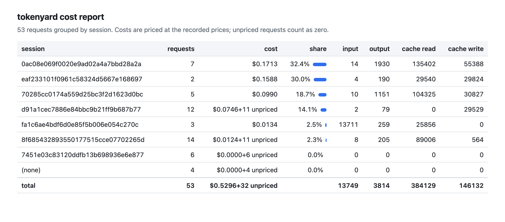

# Real sessions

Real Claude Code and Codex sessions through tokenyard against the real APIs, in two runs: Claude Code 2.1.316 and Codex 0.166.0 on 2026-11-02, Claude Code 2.1.317 and Codex 0.166.0 on 2026-11-03 (UTC). They ran through the live harness, which enforces a hard cap on the spend of all live runs together with tokenyard's own budget. The data is the anonymized export in [examples/live](../examples/live): `live.ndjson.gz` (written by `traces export --anonymize` with a one-off salt that was never stored), the HTML report built from that file only, and `summary.json` (aggregates computed from it by `bench/live-summary.ts`). Tenants, teams, keys and repos are pseudonyms and client versions are dropped. Every linkable id (record and instance ids, the session, agent and prompt HMACs, the prefix hash of the tools and system block, guardrail value HMACs) is re-keyed with the export's salt, so equal values stay equal within the export but none of them matches the raw traces or another export. What is left in clear: timestamps, models, token counts, costs, route names and the policy revision (here the live policy's name). Traces never hold prompt text.

<picture>
  <source media="(prefers-color-scheme: dark)" srcset="../examples/live/report-dark.png">
  
</picture>

The report prices each request at its recorded cost; a refused request has none, so the report counts it as "unpriced" (for example "+11 unpriced") and adds nothing for it. Why each was refused is listed under Refusals below.

Cost per Claude Code session, tokenyard's own figure against the `total_cost_usd` Claude Code printed at the end of each session (copied from [the live log](../test/live/claude-code.live.md)). Sessions 1 to 5 are the first run, 6 to 11 the second:

| Session | Model | Billed requests | Main and subagent turns | tokenyard | Claude Code | Cache hit ratio |
|---|---|---:|---|---:|---:|---:|
| 1 | Sonnet 5.5 | 7 | 4 and 3 | $0.171340 | $0.1713382 | 70.96% |
| 2 | Sonnet 5.5 | 5 | 3 and 2 | $0.099030 | $0.0990300 | 77.19% |
| 3 | Opus 5.5 | 2 | 2 and 0 | $0.158844 | $0.1588440 | 49.76% |
| 4 | Sonnet 5.5 | 1 | 1 and 0 | $0.074617 | $0.0746165 | 0.00% |
| 5 | Sonnet 5.5 | 3 | 3 and 0 | $0.012376 | $0.0123766 | 99.36% |
| 6 | Haiku 5.5 | 1 | 1 and 0 | $0.002157 | $0.002156575 | 0.00% |
| 7 | Haiku 5.5 | 17 | 11 and 5, plus 1 compaction | $0.012180 | $0.012180325 | 85.78% |
| 8 | Opus 5.5 | 2 | 2 and 0 | $0.101979 | $0.1019788 | 49.66% |
| 9 | Haiku 5.5 | 15 | 6 and 9 | $0.010198 | $0.010197095 | 83.14% |
| 10 | Haiku 5.5 | 0 | refused at the first request (budget block) | $0.000000 | $0 | n/a |
| 11 | Haiku 5.5 | 7 | 7 and 0, then refused (budget block) | $0.002590 | $0.002589415 | 95.55% |

- **Cost.** Over the 11 sessions tokenyard counted $0.645311 and Claude Code $0.6453075. tokenyard rounds each request half up to a whole micro-USD; Claude Code reports a float. Per request, the token counts were equal to Claude Code's own OTel `api_request` events wherever both were captured. In the second run all 42 OTel `api_request` events joined one to one to a trace record: OTel $0.12910221, tokenyard $0.129104, a difference of 1.79 micro-USD (0.00139%) in total and at most 0.495 micro-USD on one request ([the live log](../test/live/claude-code.live.md) has the join).
- **Cache.** Cache reads were 78.27% of all prompt tokens over the 60 billed Claude Code requests (71.02% in the first run, 83.10% in the second). tokenyard forwards the body bytes unchanged, so the cache breakpoints Claude Code sets reach the provider as sent. The second run also sent one identical scripted 5-turn Haiku 5.5 session through the gateway and once direct, each starting cold: cache reads were 79.94087% of prompt tokens through the gateway and 79.94088% direct. The direct run went around the gateway's cap; it cost $0.002236, listed in `summary.json` (`run2FromLog`) and not in the total below. The same comparison on a 40-turn session is on the mock ([Measured](benchmarks.md#measured), cache economics).
- **Bound to actual (the tokenizer assumption).** 72 requests were billed in all (Claude Code, Codex and the scripted cache session). 65 used the bytes bound, and their billed input was 0.199 to 0.348 of it; 7 used the context-window bound. No billed request exceeded its bound: 0 violations.
- **Reservations.** An ordinary Claude Code turn reserved $1.66 to $1.84 on Sonnet 5.5, $3.30 to $3.58 on Opus 5.5 and up to $0.44 on Haiku 5.5, for turns that cost a few cents or less. A Sonnet turn whose history held a `tool_reference` block reserved $5.81 (context-window bound). Codex on gpt-5.4-mini reserved $0.69 to $0.74 for its first turn and $0.96 (first run) or $1.29 (second run, after the Responses worst case began counting cache writes on top of input) for each later one, whose encrypted reasoning items force the context-window bound.
- **Refusals.** In the first run 32 of the 53 recorded requests were refused. 25 by the budget: Claude Code's WebSearch request (one `web_search_20250305` server tool, `max_uses` 8) needs a worst-case reservation of $58.16 on Sonnet 5.5 (computed by the estimator from the traced features; a refused record carries no reservation), so all 11 attempts were refused, and 11 context-window Sonnet turns at $5.81 and 3 Opus requests at $9.15 from a client without a Claude Code User-Agent were refused for the same reason. To keep the runs small, the cap was lowered from the shell for each harness start: $3, then $5, then $8 (the cap is cumulative over all live runs). The Opus requests came during the $3 start, the Sonnet turns during the $5 start and the WebSearch requests during the $8 start, so each reservation was larger than its run's whole cap; spend already charged at those moments was $0.17, $0.50 and $0.51. Caps and amounts are in `summary.json`, the caps from the live logs. 6 were the first Codex attempt, refused because Codex sent a tool type the gateway did not know yet (it now looks inside it), and 1 asked for a model the live route does not allow. In the second run 7 of 58 were refused: 5 by the budget, on purpose (the budget block below), and 2 hand-made encoded bodies (`content-encoding`). The refusals are the hard bound working as designed; see [Limitations](security.md#limitations).
- **Budget block.** In the second run the harness was restarted twice with the cap just above the spent amount. At $0.704842 (spent $0.674842) Claude Code's first request reserved $0.066392 and was refused at once with 429 and `x-should-retry: false`; `claude -p` printed the message after 1 s and made no retry, and Codex's first request (reservation $0.740598) got 429 `insufficient_quota` and Codex stopped after that 1 request. At $0.754842 a Haiku session with `max_tokens` of 1,000 had 7 requests admitted and billed, and the next one (reservation $0.07796 with $0.677432 spent) was refused, again shown at once. Every harness start in `summary.json` (`starts`) ended within its cap.
- **Codex.** One task in each run (read a file, add a one-line comment): 3 billed requests and $0.013388 in the first, 4 and $0.016497 in the second, cache reads 65.35% and 73.5% of prompt tokens. Codex 0.166.0 sent no `Content-Encoding` header to the API-key base URL; tokenyard forwards such bodies unchanged and refuses an encoded body with 400 before reading it. Details and the `response.completed` usage shape are in [the Codex live log](../test/live/codex.live.md).
- **Total live spend**, every request, by tokenyard's own counter: $0.677432 ($0.529595 in the first run, $0.147837 in the second). Every billed request was settled by the request itself and none overran its reservation (0 overruns).

The estimator calibration rows at the end of the [Measured](benchmarks.md#measured) block come from the same live runs.
